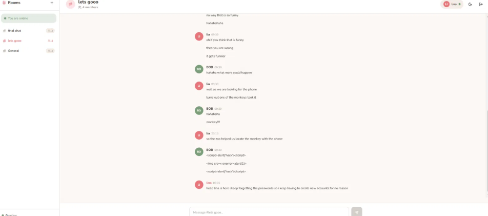

# Realtime Chat

[](https://github.com/oumaima-coco/realtime-chat-app/actions/workflows/ci.yml)

A production-grade, full-stack multi-room chat application. Real-time messaging over WebSockets, JWT-authenticated handshake, PostgreSQL persistence, multi-tab presence tracking, typing indicators, and a polished responsive UI with light and dark mode.


## Features

- **Real-time messaging** via Socket.io with a dual-write persistence pattern (write first, broadcast second) — chat history survives server restarts
- **Multi-room conversations** with per-room membership enforcement and scoped broadcasts
- **JWT authentication** with bcrypt (cost factor 12) and 7-day tokens; enumeration-safe error responses
- **Cursor-based message pagination** stable under concurrent inserts (unlike offset pagination)
- **Multi-tab presence tracking** backed by a server-side `Map<userId, Set<socketId>>` — a user remains online as long as any tab stays connected
- **Debounced typing indicators** with client-side 3s timeout and server-side 10s safety cleanup for crashed clients
- **Production-grade security** — Helmet, tiered rate limiting, body-size limits, parameterized SQL, XSS-safe React rendering
- **Dark mode** via CSS variable overrides — a single class toggle on `<html>` theme-switches the entire app without component rewrites
- **CI pipeline** via GitHub Actions that type-checks and builds both client and server on every push
- **Responsive design** — mobile-first, works from 375px up

## Tech Stack

**Frontend** — React 18 · Vite · TypeScript · Tailwind CSS v3 · shadcn-style primitives · Socket.io client · React Router · Lucide icons

**Backend** — Node.js 22 · Express · TypeScript (ES Modules) · Socket.io · PostgreSQL 18 · `pg` with custom migration runner · Helmet · express-rate-limit · Zod · bcrypt · jsonwebtoken

**Tooling** — GitHub Actions CI · ESLint · PostCSS · Conventional Commits

## Screenshots

| Chat — Dark mode | Chat — Light mode |
|---|---|
|  |  |

| Login | Register |
|---|---|
|  |  |

## Architecture

Three-layer backend with clear separation of concerns:

```
┌────────────────────────────────────────────┐
│  Route      → validates input, calls...    │
│  Controller → orchestrates, calls...       │
│  Service    → business logic, DB queries   │
└────────────────────────────────────────────┘
```

Real-time messaging uses a **dual-write pattern**: the server persists each message to PostgreSQL first, then broadcasts to all connected clients in the room via Socket.io. This guarantees message history survives server restarts and that every client sees the same authoritative view.

Socket.io rooms are used as scoping primitives — `socket.join(roomId)` on room entry ensures broadcasts reach only members of that room. All business logic lives in services that are callable from both HTTP routes and WebSocket handlers, keeping the authorization story consistent across transports.

## Getting Started

### Prerequisites
- Node.js 22+
- PostgreSQL 18+
- npm 10+

### Setup

```bash
git clone https://github.com/oumaima-coco/realtime-chat-app.git
cd realtime-chat-app

cd server && npm install
cd ../client && npm install
```

### Configure environment variables

```bash
cp server/.env.example server/.env
cp client/.env.example client/.env
```

Edit `server/.env` to point at your local PostgreSQL and set a JWT secret. Generate a secure random secret:

```bash
node -e "console.log(require('crypto').randomBytes(64).toString('hex'))"
```

### Set up the database

```bash
cd server
npm run migrate
```

Creates four tables (`users`, `rooms`, `room_members`, `messages`) and a `_migrations` tracking table.

### Run the app

Two terminal windows:

```bash
# Terminal 1: backend
cd server
npm run dev
```

```bash
# Terminal 2: frontend
cd client
npm run dev
```

Open [http://localhost:5173](http://localhost:5173) — register a new account and start chatting.

## Project Structure

```
realtime-chat-app/
├── .github/workflows/      CI pipeline (GitHub Actions)
├── server/
│   ├── src/
│   │   ├── config/         Environment loading and validation
│   │   ├── db/
│   │   │   ├── migrations/ SQL migration files
│   │   │   ├── migrate.ts  Custom migration runner
│   │   │   └── pool.ts     PostgreSQL connection pool
│   │   ├── middleware/     Auth, logging, rate limits, error handling
│   │   ├── routes/         Express route definitions
│   │   ├── controllers/    Route handlers
│   │   ├── services/       Business logic layer
│   │   ├── socket/         Socket.io handlers and middleware
│   │   ├── types/          Shared TypeScript types
│   │   └── index.ts        Server entry point
│   └── package.json
│
└── client/
    ├── src/
    │   ├── api/            HTTP client wrappers
    │   ├── components/     Reusable UI components
    │   │   └── ui/         shadcn-style primitives
    │   ├── context/        React contexts (Auth, Rooms, Presence, Theme)
    │   ├── hooks/          Custom hooks (useSocket, useTypingIndicator)
    │   ├── pages/          Route components
    │   ├── types/          Shared TypeScript types
    │   ├── lib/            Utility helpers
    │   ├── tokens.css      Design token CSS variables
    │   └── index.css       Global styles + Tailwind directives
    └── package.json
```

## Security

Defense-in-depth hardening applied at every layer:

- **Helmet** security headers (X-Content-Type-Options, X-Frame-Options, HSTS, CSP, and more)
- **Tiered rate limiting** — auth endpoints (5/15 min), write endpoints (20/min), general API (100/min)
- **Body-size limits** — 100 KB on both HTTP requests and Socket.io payloads
- **Parameterized SQL** everywhere via `pg` — no string concatenation, no injection risk
- **bcrypt** at cost factor 12 for password storage
- **Enumeration prevention** — register and login return identical errors so attackers can't probe for valid usernames
- **JWT** with signed tokens and 7-day expiry
- **React JSX auto-escaping** — verified against `<script>` payload injection
- **CORS** locked to specific origins, not wildcard
- **Global error handler** that suppresses stack traces in production
- **React ErrorBoundary** to prevent white-screen crashes

## Engineering Highlights

- **Full-stack TypeScript** with shared type definitions across the HTTP and WebSocket boundaries
- **Three-layer backend architecture** that keeps services testable and transport-agnostic
- **CSS-variable-based theming** that enables light/dark mode with zero component rewrites
- **Dual-write pattern** for message persistence — a production approach to real-time durability
- **Cursor-based pagination** instead of offset — stable under concurrent inserts, the pattern used by production chat apps
- **Multi-tab-aware presence** — correctly handles the common case of a user with the app open in several browser tabs
- **CI pipeline** that type-checks and builds on every push, catching regressions before merge
- **12 clean commits** following Conventional Commits (`feat:`, `fix:`, `docs:`, `ci:`), each a working feature end-to-end

## License

MIT.